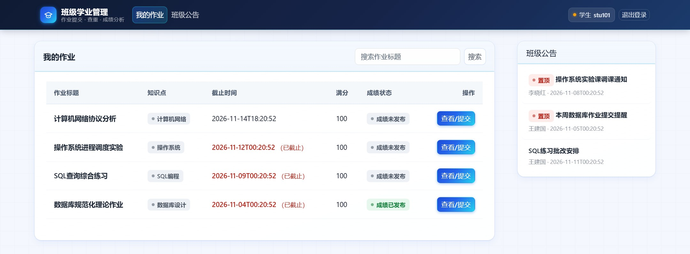
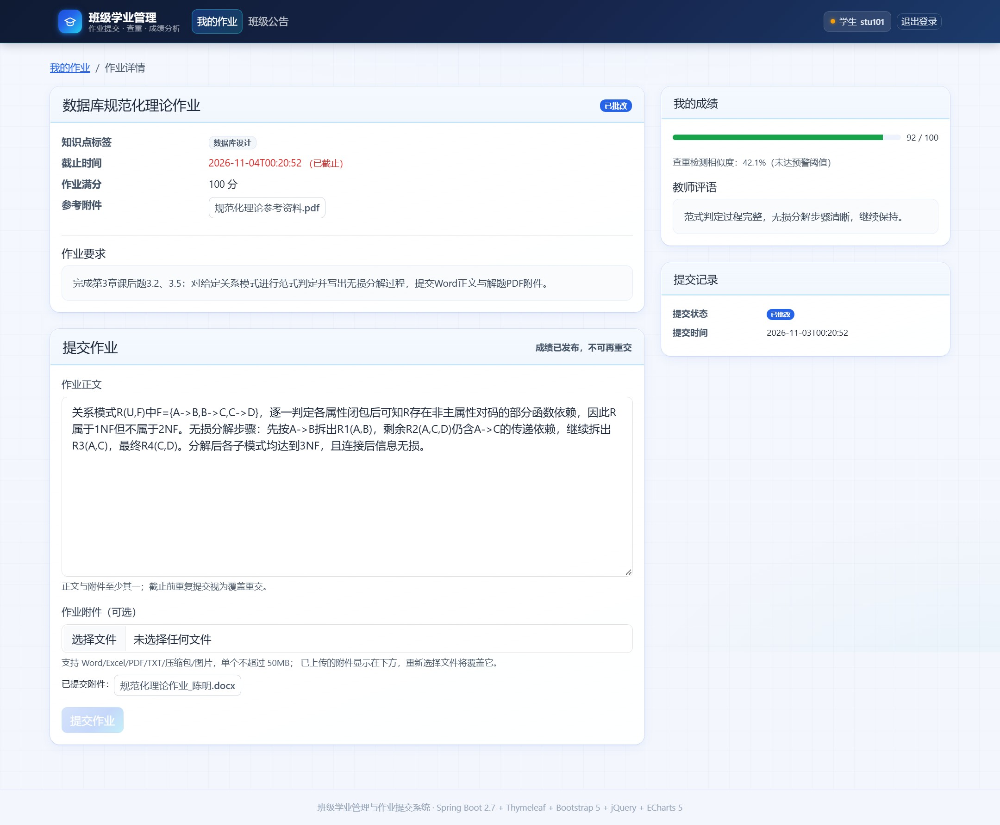
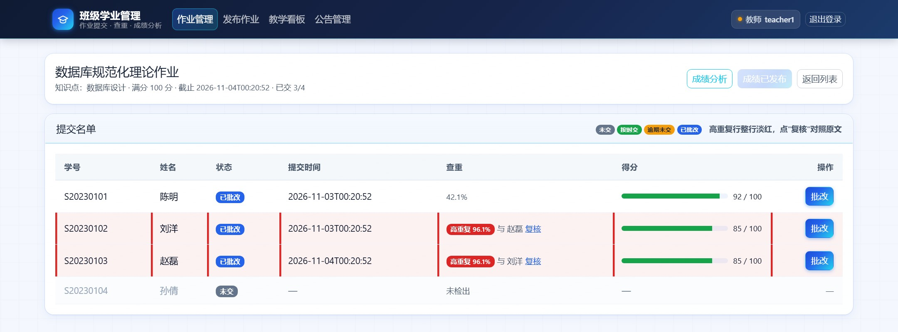
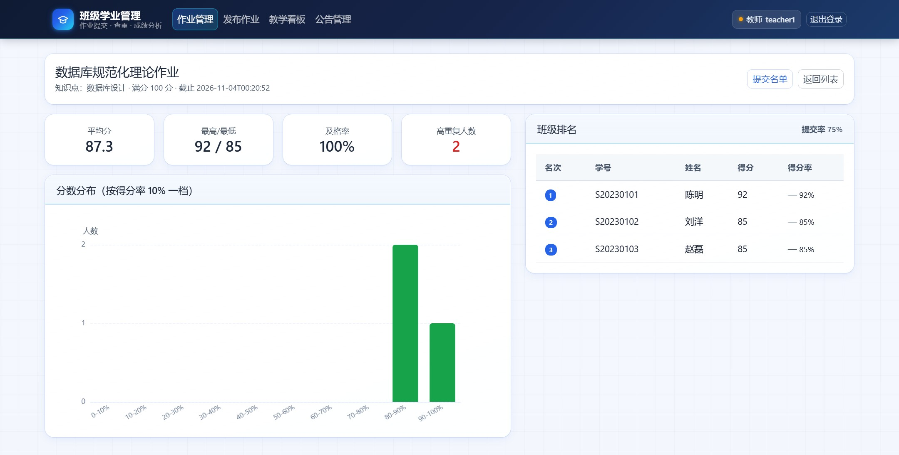
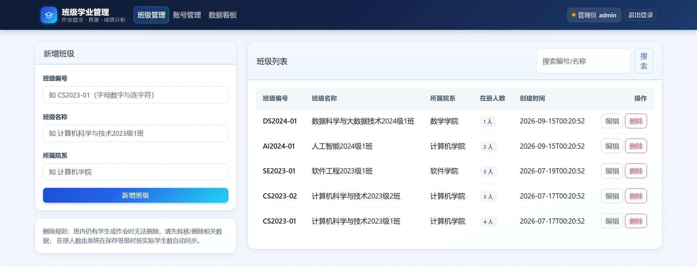
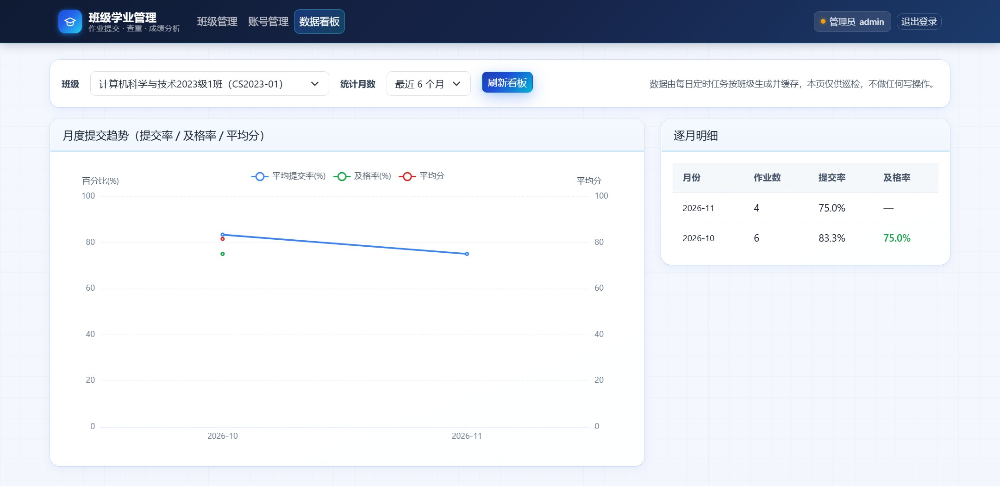
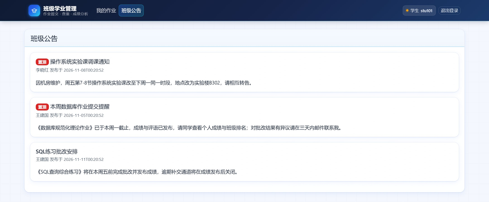
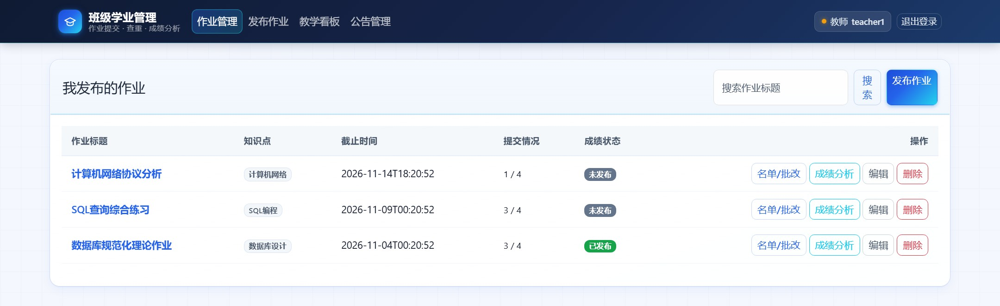
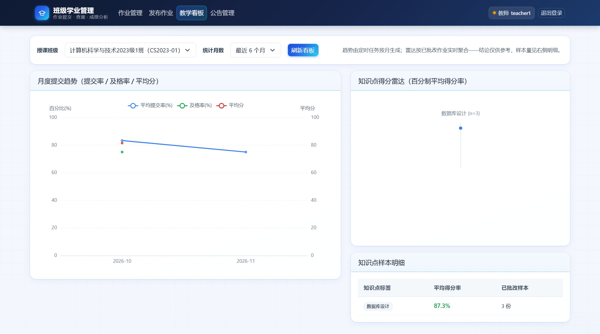
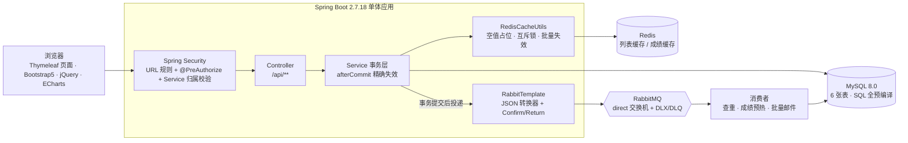

<div align="center">


# 班级学业管理与作业提交系统

**交作业、批作业、看教学数据——一个系统全搞定。**

学生不用再问「作业交给谁、几号截止、我多少分」；老师不用再手工汇总 Excel；
教务不用再翻纸质名单核对谁在哪个班。

[](https://openjdk.org/projects/jdk/17/)
[](https://spring.io/projects/spring-boot)
[](https://www.mysql.com/)
[](https://redis.io/)
[](https://www.rabbitmq.com/)
[](#六质量与验证)
[](#六质量与验证)

[三分钟跑起来](#四三分钟跑起来) · [界面速览](#三界面速览) · [技术亮点](#五技术亮点) ·
[**项目开发文档**](docs/项目开发文档.md) · [**Linux 部署说明**](deploy/Linux部署说明.md)

</div>

---

## 一、这是什么

一个**面向高校班级场景**的作业全流程系统：教师发作业 → 学生交作业 → 系统自动查重 →
教师批改打分 → 一键发布成绩 → 学生查分 → 班级教学看板出趋势。

它不是「增删改查练习」：真机上跑过 **55 项自动化断言 + 5 阶段压测**，
跑完应用日志里 **ERROR 为 0**、**0 条 MQ 降级**（[怎么验证的](#六质量与验证)）。

> **除了代码，还有两份材料必看**：
> [项目开发文档](docs/项目开发文档.md)（需求分析 / E-R 图 / 系统设计 / 模块分工 / 测试结论）
> 与 [Linux 部署说明](deploy/Linux部署说明.md)（安装、环境变量、systemd、Nginx、排障）。
> 只看 README 会漏掉设计细节和上线步骤。

| 关键数字 | 说明 |
|---|---|
| **3 种角色** | 学生 / 教师 / 教务管理员，权限与数据归属逐层校验 |
| **6 张表** | 班级、用户、作业、提交、公告、月度统计 |
| **13 个页面** | 服务端渲染 + ECharts 图表，静态库全部本地化（离线可用） |
| **82 个 Java 源文件** | 注释率 44%+，无一处 `TODO` 占位 |
| **55 项自动化断言** | 冒烟 37 + MQ 接线 7 + 压测 4 + 队列回收 3 + 日志健康度 4 |

---

## 二、三个角色，各看各的界面

| 角色 | 他能做什么 |
|---|---|
| **学生**（`stu101`） | 只看本班作业；截止前可覆盖重交；提交正文 + 附件（≤50MB，扩展名白名单）；成绩发布后才看得到分数、评语、班级排名与查重结论 |
| **教师**（`teacher1`） | 发布/编辑作业；看提交名单（含未交占位）、查重率与高重复预警；在线批改；一键发布成绩；看分数分布、知识点雷达、月度趋势 |
| **管理员**（`admin`） | 班级 CRUD、师生账号 CRUD、CSV 批量导入学生（整批事务，任一行错则整批不入库）、任意班级数据巡检 |

> 所有账号密码统一 `123456`（BCrypt 密文入库），完整名单见[附录](#附录测试账号)。

---

## 三、界面速览

### 学生端：我的作业一眼看清「交没交、来不来得及、多少分」

<table>
  <tr>
    <td width="50%"></td>
    <td width="50%"></td>
  </tr>
  <tr>
    <td align="center"><sub>只列本班作业，状态徽章 + 截止时间标红</sub></td>
    <td align="center"><sub>成绩发布后可见分数 / 评语 / 查重率；发布后禁止重交</sub></td>
  </tr>
</table>

### 教师端：查重直接标红，批改不用再开 Excel

<table>
  <tr>
    <td width="50%"></td>
    <td width="50%"></td>
  </tr>
  <tr>
    <td align="center"><sub>相似度 ≥85% 整行标红，互相指向「最相似同学」，点开可对照原文</sub></td>
    <td align="center"><sub>平均分 / 及格率 / 分数分布直方图 / 班级排名，一次发布即出图</sub></td>
  </tr>
</table>

### 管理端：班级与账号维护，人数自动对齐

<table>
  <tr>
    <td width="50%"></td>
    <td width="50%"></td>
  </tr>
  <tr>
    <td align="center"><sub>在册人数随学生增删自动同步；有作业/学生时删除会被拦下</sub></td>
    <td align="center"><sub>任意班级的月度提交率 / 及格率 / 平均分趋势</sub></td>
  </tr>
</table>

<details>
<summary><b>展开看更多界面（公告、教学看板、作业列表）</b></summary>

<table>
  <tr>
    <td width="50%"></td>
    <td width="50%"></td>
  </tr>
  <tr>
    <td align="center"><sub>班级公告（置顶优先）</sub></td>
    <td align="center"><sub>教师作业列表：已交 3/4、成绩未发布一目了然</sub></td>
  </tr>
  <tr>
    <td colspan="2"></td>
  </tr>
  <tr>
    <td colspan="2" align="center"><sub>教学看板：月度提交率 / 及格率 / 平均分趋势 + 知识点得分率雷达</sub></td>
  </tr>
</table>

</details>

---

## 四、三分钟跑起来

### 第 1 步：建库（一条命令）

```bash
# 先保证本机 MySQL 8.0 已启动（默认 3306 / root）
mysql -uroot -p --default-character-set=utf8mb4 < sql/homework_init.sql
```

> 不想用命令行？把 `sql/homework_init.sql` 全文粘进 Navicat / DataGrip 执行也可以。
> 脚本会自动建库 `campus_homework`、建 6 张表并写入演示数据（17 个账号、6 份作业、15 条提交）。

### 第 2 步：启动

```bash
mvn spring-boot:run
# 或者：mvn clean package -DskipTests && java -jar target/campus-homework.jar
```

默认 `dev` profile，端口 **9090**（test 9092 / prod 8080）。
Redis 与 RabbitMQ 用本机默认端口即可；**没有它们也能启动**（缓存自动降级回源、MQ 投递降级为 WARN）。

### 第 3 步：登录

打开 <http://localhost:9090/login>，用下面任一账号（密码统一 `123456`）：

| 账号 | 角色 | 推荐先看什么 |
|---|---|---|
| `stu101` | 学生 | 我的作业 → 作业「数据库规范化理论作业」（已批改，92 分） |
| `teacher1` | 教师 | 提交名单（看 stu102/stu103 的 96.1% 高重复预警）→ 成绩分析 |
| `admin` | 管理员 | 班级管理 → 数据看板 |

> 想验证越权防护？用 `stu101` 直接访问作业 5（属别的班）会拿到 403；
> 用 `teacher3` 访问作业 1 的名单同样 403。细节见开发文档的「越权测试」一节。

---

## 五、技术亮点



- **缓存三防**：`__NULL__` 占位防穿透；SETNX 互斥锁 + Lua 令牌解锁（10s TTL 防死锁）防击穿；
  写路径在事务 `afterCommit` 精确失效，SCAN 批量清理个人成绩键。
  读路径全程 `try-catch` 降级回源——Redis 挂了业务照样跑。
- **MQ 三类异步**：提交后异步查重、发布成绩后异步预热查分缓存 + 批量发通知邮件；
  手动 ACK，异常 `nack(requeue=false)` 直接进死信队列（DLQ 留档供排查重放），不做无限重投。
- **查重算法零依赖**：纯 JDK 实现 3-gram 分词 + 余弦相似度，相似度 ≥0.85 触发高重复预警
  （演示数据里 stu102 与 stu103 高达 **96.1%**，两人互指为「最相似同学」）。
- **越权三重防线**：URL 规则 → 方法注解 → Service 层按登录态校验数据归属。
  最后一层是兜底：即使前两层配错，学生也拿不到别班的作业、教师改不了别人的作业。
- **定时任务**：每 10 分钟标记逾期、每天 8:30 催交邮件、每月 1 日生成月度统计（报表数据源）。

---

## 六、质量与验证

不是「跑起来没报错」，而是**把结论做成可重复的断言**：`scripts/` 下两个纯标准库脚本，
一条命令从建库跑到压测出报告（Windows / Linux 通用，不需要装任何 Python 包）。

```bash
python scripts/run_all.py all          # 建库校验 → 单测 → 打包 → 起 Redis/MQ/应用 → 冒烟 → 压测 → 日志裁决
python scripts/smoke_load_test.py all  # 只跑 e2e（自动拉起 Redis / RabbitMQ / 应用）
python scripts/smoke_load_test.py mqseed  # 只验证 MQ：拓扑预建 + 3 条业务链路 + 3 条死信链路
```

**最近一次全绿结果**（报告快照见 [`docs/测试报告.txt`](docs/测试报告.txt)）：

| 检查项 | 结果 |
|---|---|
| 建库 + 数据自洽 | 6 表行数、5 个班在册人数、6 份作业提交数 **全 PASS** |
| 单元测试 `mvn test` | **21 / 21**，BUILD SUCCESS |
| 冒烟断言 | **44 / 44**（登录鉴权、三端主流程、IDOR 越权、边界异常、MQ 接线） |
| 压测 | 5 阶段 **0 错误 / 100% 成功**：热点读 ~220-560 req/s、公共读 ~5200 req/s、教师读 ~1000-1250 req/s、登录风暴 ~300 req/s |
| MQ 链路 | 拓扑 **14/14**（2 交换机 + 6 队列 + 6 绑定）、三类业务链路 + 三条死信链路全通、消息头 `__TypeId__` 正确 |
| 应用日志 | 约 1.4 万行：**ERROR = 0**、WARN 10 条（全部预期类别）、**MQ 降级 0 条** |

> 压测刻意用长连接 + `TCP_NODELAY`，测的是服务端吞吐而非连接建立开销；
> 登录风暴最慢是因为 BCrypt 每次要算 50-100ms，属于预期。
> 日志断言还会校验「有启动完成证据」，避免空日志被误判成零 ERROR。

---

## 七、文档导航

代码之外还有三份材料，**答辩、部署、复现**分别看它们：

| 文档 | 里面写了什么 | 什么时候看 |
|---|---|---|
| [**项目开发文档**](docs/项目开发文档.md) | 需求分析、用例、E-R 图（全 6 表）、系统设计、接口约定、模块分工、测试结论 | 想搞懂「为什么这么设计」，或答辩评审 |
| [**Linux 部署说明**](deploy/Linux部署说明.md) | JDK / MySQL / Redis / RabbitMQ 安装、环境变量注入、systemd 与 nohup 两种托管方式、Nginx 反代、验证清单与故障排查 | 要把它部署到服务器上 |
| [**测试报告快照**](docs/测试报告.txt) | 55 项断言逐条结果、5 阶段压测数据、日志级别计数 | 想看「全绿」的原始证据 |

其他约定与执行计划：`AGENTS.md`（工程铁律）、`homework-plan.md`（5 个 Batch 的实施剧本）。

---

## 八、项目结构

```text
campus-homework/
├── pom.xml                       # Spring Boot 2.7.18 / JDK 17 / 50MB 上传上限
├── sql/homework_init.sql         # 建库建表 + 演示数据（BCrypt 密文，明文统一 123456）
├── docs/
│   ├── 项目开发文档.md            # 需求 / E-R / 设计 / 分工 / 测试
│   ├── 测试报告.txt               # 最近一次全绿运行的断言与压测快照
│   └── images/                   # README 用的真机截图
├── deploy/Linux部署说明.md        # 部署运维手册
├── src/main/java/com/campus/homework/
│   ├── config/                   # Security / Redis / RabbitMQ / MyBatis-Plus
│   ├── controller/               # Auth / Student / Teacher / Admin / Common / File / Page
│   ├── service/ impl/            # 事务、缓存同步、MQ 投递都在这一层
│   ├── mapper/ entity/ dto/ vo/  # SQL 全 #{} 预编译；出参剔除敏感字段
│   ├── mq/                       # 查重 / 成绩统计 / 邮件 三个消费者
│   └── task/                     # 逾期标记 / 催交邮件 / 月度统计
├── src/main/resources/
│   ├── application.yml + -dev/-test/-prod.yml
│   ├── templates/                # Thymeleaf：1 个布局片段 + 13 个页面
│   └── static/                   # 本地化 Bootstrap5 / jQuery / ECharts + api.js + app.css
├── src/test/java/…/utils/        # 21 项单元测试（查重 / 上传安全 / 响应契约）
└── scripts/                      # run_all.py（流水线）+ smoke_load_test.py（55 项断言）
```

---

## 九、几个需要知道的取舍

- **视图层锁定 Thymeleaf + Bootstrap 5 + jQuery + ECharts**（课程要求，禁 Vue/React），
  静态库全部放在 `static/vendor` 本地化，断网也能打开页面。
- **dev 环境刻意关掉 MQ 自动声明与消费者自启动**（`dynamic=false`、`auto-startup=false`）：
  方便本机观察消息堆积、也不会后台消费干扰调试。因此 dev 下拓扑需要预建——
  跑一次 `python scripts/smoke_load_test.py mqseed` 即可；`prod` 由应用启动时自动声明。
- **邮件默认关闭**（`homework.mail.enabled=false`）：dev 只记日志不真发，本机没有 SMTP 也不会报错。
- **状态码口径**：统一响应体 `Result<T>` 用 `code` 承载 HTTP 语义，
  所以 Service 层的越权会返回「HTTP 200 + body code=403」，前端按 `code` 判定跳转与提示。

---

## 附录：测试账号

<details>
<summary><b>展开完整账号清单（17 个：1 管理员 + 3 教师 + 13 学生）</b></summary>

**管理员**

| 账号 | 姓名 | 说明 |
|---|---|---|
| `admin` | 教务处管理员 | 班级 / 账号 / CSV 导入 / 数据看板 |

**教师**

| 账号 | 姓名 | 授课与作业 |
|---|---|---|
| `teacher1` | 王建国 | 计科 2023-1 班：作业 1（数据库规范化）、作业 2（SQL 练习）、作业 4（协议分析） |
| `teacher2` | 李晓红 | 计科 2023-1 班作业 3（操作系统实验）、计科 2023-2 班作业 5（Java OO） |
| `teacher3` | 张卫民 | 软工 2023-1 班作业 6（SRS）——跨班用于测试教师越权防护 |

**学生（13 人）**

| 账号 | 姓名 | 班级 |
|---|---|---|
| `stu101` / `stu102` / `stu103` / `stu104` | 陈明 / 刘洋 / 赵磊 / 孙倩 | 计科 2023-1 班（CS2023-01） |
| `stu201` / `stu202` / `stu203` | 周涛 / 吴迪 / 郑爽 | 计科 2023-2 班（CS2023-02） |
| `stu301` / `stu302` / `stu303` | 黄强 / 徐丽 / 马俊 | 软工 2023-1 班（SE2023-01） |
| `stu401` / `stu402` | 林峰 / 何雪 | 人工智能 2024-1 班（AI2024-01） |
| `stu501` | 诸一帆 | 数据科学 2024-1 班（DS2024-01） |

统一明文密码 `123456`；`stu102` 与 `stu103` 的作业 1 正文高度雷同，用来演示 96.1% 高重复预警。

</details>

<div align="center">
<sub>如果这个项目对你有帮助，欢迎点个 Star；问题与建议请提 Issue。</sub>
</div>
