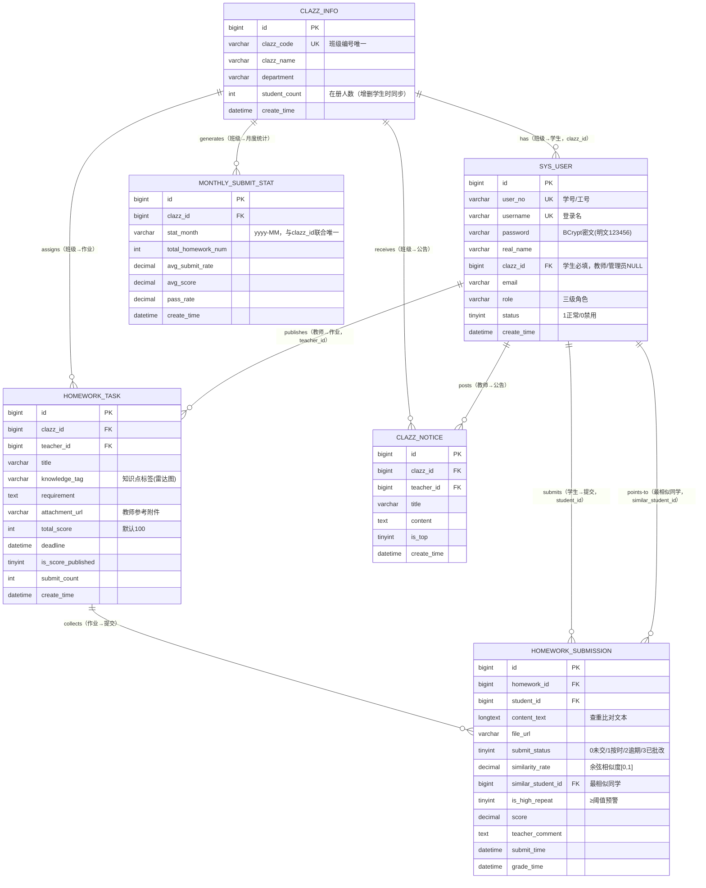
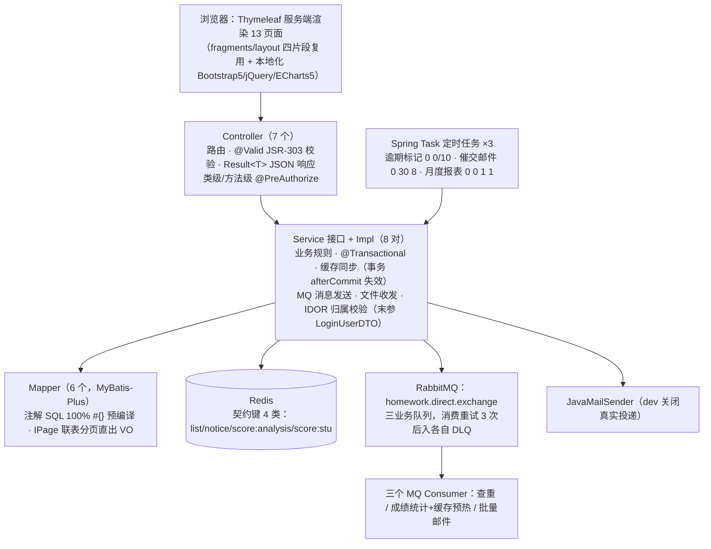

# 班级学业管理与作业提交系统 — 项目开发文档

---

## 一、需求分析

### 1.1 项目背景与定位

面向高校班级场景的学业管理与作业提交系统：解决"教师布置作业靠群消息、收作业靠手工点名、查重靠肉眼比对、成绩分析靠 Excel"的低效现状，覆盖 **作业发布 → 在线提交 → 异步查重 → 批改发布 → 成绩与排名查看 → 教学数据看板** 的完整业务闭环，并按课程任务书要求落地企业级中间件实践（Redis 缓存、RabbitMQ 死信队列、定时任务、Linux 部署）。

### 1.2 角色与用例

系统含三级角色（与 Spring Security 角色一一对应）：

| 角色 | 权限标识 | 核心用例 |
|---|---|---|
| 学生 | ROLE_STUDENT | 查看本班作业列表（倒计时/状态徽章）、提交与覆盖重交、查看成绩/班级排名/知识点得分率、查看班级公告 |
| 任课教师 | ROLE_TEACHER | 发布/编辑/删除作业（知识点标签、截止时间、附件）、查看提交名单与未交标记、在线批改打分写评语、一键发布成绩、成绩分析（直方图/雷达图）、教学看板、发布公告 |
| 教务管理员 | ROLE_ADMIN | 班级 CRUD、师生账号 CRUD/重置密码/启停用、CSV 批量导入学生、任意班级数据巡检看板 |

核心用例清单（编号供追溯矩阵引用）：

- **UC-S01** 查看作业列表：仅展示本人班级教师发布的作业，含未交/按时/逾期/已批改四种状态徽章与截止倒计时。
- **UC-S02** 提交作业：正文 + 附件（≤50MB、扩展名白名单）；截止前可无限次覆盖重交，每次重交后自动重新触发异步查重。
- **UC-S03** 查看成绩：成绩发布前对教师以外的任何人（包括接口直接试探）严格隐藏分数、评语与查重结论；发布后可见个人成绩、班级排名、最相似同学提示。
- **UC-T01** 发布作业：目标班级 + 知识点标签 + 截止时间 + 总分（默认100）+ 参考附件。
- **UC-T02** 批改与发布：逐份打分写评语；"一键发布"后由 MQ 异步完成成绩统计、Redis 查分缓存全量预热与批量邮件通知。
- **UC-T03** 查重复核：查看全班相似度排序，≥0.85 的提交红色高亮并附最相似同学，教师可人工复核。
- **UC-T04** 成绩分析/看板：分数分布直方图、平均分/及格率、知识点得分率（ECharts），月度提交率趋势。
- **UC-A01** 班级与账号管理：班级编号唯一；删除班级时存在作业/在册学生则拒绝（引用完整性兜底）。
- **UC-A02** CSV 批量导入：UTF-8、首行表头、列序 `user_no,username,real_name,email,clazz_id`、上限 1000 行；**整批事务**——任一行失败整批一条不入库，并产出逐行错误报告（"第 12 行邮箱为空、第 31 行学号已存在"）供管理员一次修正后重传。
- **UC-C01** 系统级：登录登出、安全分流首页、文件上传下载接口、逾期标记/催交邮件/月度报表三类自动化。

### 1.3 非功能需求与约束（来自 AGENTS.md 工程契约）

1. **安全**：MyBatis 100% `#{}` 预编译（`${}` 视为严重事故）；IDOR 三重防线（URL 规则 + `@PreAuthorize` + Service 层归属校验）；密码仅 BCrypt 密文入库、出参一律剔除。
2. **工程质量**：零占位符（无 TODO/省略）；注释率 ≥20%（实测 44%+）；禁止跨层调用（Controller 禁注入 Mapper / 拼 QueryWrapper）；禁止瑞吉外卖（Reggie）特征命名。
3. **视图层死锁**：Thymeleaf + Bootstrap 5 + jQuery + ECharts 5 服务端渲染，`th:fragment/th:replace` 抽公共布局，禁 Vue/React，静态库全部本地化（离线可用）。
4. **中间件契约**：Redis（穿透/击穿防护 + 事务感知失效 + 故障降级）、RabbitMQ（三业务队列 + 死信 DLQ + 手动 ACK）、Spring Task 三定时表达式、JavaMailSender。
5. **交付**：可直接导入 IDEA 的源码、建库 SQL、开发文档、部署手册、答辩 PPT、Git 提交历史。

---

## 二、数据库设计

### 2.1 E-R 概念模型

说明：物理表**不建外键约束**（索引注释中标注逻辑外键），引用完整性与"删除班级时存在作业/学生则拒绝"的约束在 Service 层做引用校验兜底；`similar_student_id` 是提交表指向用户表的自参照（查重结果指针），故 E-R 中为提交与用户的第三种关系。

### 2.2 关系表与索引设计

| 表 | 用途 | 关键索引 | 设计理由 |
|---|---|---|---|
| clazz_info | 班级 | `uk_clazz_code` | 班级编号业务唯一 |
| sys_user | 用户 | `uk_user_no`、`uk_username`、`idx_user_clazz` | 学号与登录名双唯一；按班查人走索引 |
| homework_task | 作业 | `idx_task_clazz`、`idx_task_teacher`、`idx_task_title`、`idx_task_deadline` | 逾期定时任务按 deadline 范围扫描走索引 |
| homework_submission | 提交 | `uk_hw_stu(homework_id, student_id)`、`idx_sub_hw`、`idx_sub_stu` | 复合唯一防"一课多人重复记录"，重交是 UPDATE 不是 INSERT |
| clazz_notice | 公告 | `idx_notice_clazz`、`idx_notice_teacher` | 列表按班过滤+教师维度审计 |
| monthly_submit_stat | 月度统计 | `uk_stat_clazz_month(clazz_id, stat_month)` | 定时任务重跑幂等：唯一冲突改覆盖而非重复插数 |

### 2.3 数据字典（要点）

- 所有时间列 DATETIME + DEFAULT CURRENT_TIMESTAMP；对外 JSON 统一 `yyyy-MM-dd HH:mm:ss` + GMT+8。
- 所有状态列 TINYINT + 注释 + Constants 常量映射（禁止魔法数字散落代码）。
- `similarity_rate DECIMAL(5,4)`、`score DECIMAL(5,1)`、`avg_submit_rate DECIMAL(5,2)`：与算法输出精度严格一致。
- 全库 utf8mb4 / InnoDB；SQL 全 UTF-8 无 BOM。
- 初始化数据自洽：5 班级 / 17 账号（1 管理员+3 教师+13 学生）/ 6 作业（4 已截止、1 临近 24h、1 未截止，覆盖逾期与催交场景）/ 15 提交（含按时、已批改、高重复预警演示、逾期补交、未交占位）/ 6 公告（2 置顶）/ 6 月度统计；核验口径：**各班 sys_user 在册实数 = clazz_info.student_count**，**每份作业已交记录数（status 1/2/3）= homework_task.submit_count**，逐条相等。

---

## 三、系统架构设计

### 3.1 分层架构（严禁跨层调用）

包结构（AGENTS.md 锁定的 12 包，全部落地）：`config / controller / service / service.impl / mapper / entity / dto / vo / exception / utils / task / mq`。

- Controller 仅路由+校验+响应，**零 Mapper 注入、零 QueryWrapper**；事务、缓存、MQ 全部在 ServiceImpl。
- 统一响应 `Result<T>`（HTTP 语义 code：200/400/401/403/404/500），GlobalExceptionHandler 把 Business/Forbidden/NotFound/FileUpload 异常与参数校验失败翻译成 code+中文 msg，HTTP 状态与业务 code 同步。
- 页面路由（PageController）只做 URL→模板映射，页面数据一律 jQuery 调 `/api/**`，天然复用 API 层的鉴权与归属校验。

### 3.2 关键机制设计

#### 安全与 IDOR 三重防线
1. **URL 规则**（SecurityConfig）：`/api/{student|teacher|admin}/**` 与同名页面前缀按角色锁定；未认证 API 返回 401 JSON、页面重定向 `/login`；BCryptPasswordEncoder 校验密码。
2. **方法注解**：Controller 类级/方法级 `@PreAuthorize("hasRole('TEACHER')")` 拦截垂直越权。
3. **Service 兜底**：全部业务方法末参 `LoginUserDTO operator`，按登录态 userId/clazzId 校验归属——即使 URL 规则误配，水平越权也拿不到别人的数据；缓存读取一律在越权校验之后。

#### Redis 缓存策略（读写契约在 Constants）
- **读路径** `listOrLoad/objectOrLoad`：命中返回；未命中回源；**空结果写 `__NULL__` 占位（TTL 60s）防穿透**；**互斥锁回源防击穿**（`SET lock:<key> NX EX 10`，抢锁失败者短暂自旋等锁，最长约 3s，等待不成立时照常回源，宁可多查绝不阻断）；反序列化失败自动删坏键重建。
- **写路径** `evict/evictByPattern`：一律注册到事务 **afterCommit**——提交后才删缓存，回滚则不删（旧缓存天然正确）；批量清理用 SCAN 游标（count 200）避免 KEYS 阻塞。
- **故障降级**：全部 Redis 操作 try-catch，Redis 宕机仅 WARN 并直接回源 MySQL——缓存是加速器不是依赖项。
- **成绩发布预热**：MQ 统计消费者对全班提交逐条写入 `homework:score:stu:{hwId}:{stuId}`（含 `__NULL__` 未交占位），查分高峰全部走缓存。

#### RabbitMQ 异步链路（手动 ACK + prefetch 1 + 重试 3 次进死信）

| 交换机/队列 | 触发点 | 消费逻辑 | 失败归宿 |
|---|---|---|---|
| homework.plagiarism.queue | 学生提交/重交（MQ 发送在事务 afterCommit） | N-Gram+余弦查重全班已交文本，回写三字段，≥0.85 预警 | homework.plagiarism.dlq → DLX 人工排查 |
| homework.score.stat.queue | 教师一键发布成绩 | 分数段统计 + 全班查分缓存全量预热 | homework.score.stat.dlq |
| homework.mail.batch.queue | 成绩发布通知/催交邮件 | JavaMailSender 逐条发送（失败不重发，记录日志） | homework.mail.batch.dlq |

#### 定时任务（Spring Task，表达式逐字符契约）

| 任务 | Cron | 逻辑 |
|---|---|---|
| OverdueMarkTask | `0 0/10 * * * ?` | 扫描已截止未提交 → 标记逾期未交；补交 → 标记逾期提交 |
| UrgeMailTask | `0 30 8 * * ?` | 截止前 24h 的作业 → 未交学生催交邮件 |
| MonthlyStatTask | `0 0 1 1 * ?` | 上月按班级聚合：作业数/提交率/平均分/及格率，唯一索引幂等 upsert |

#### 查重算法（零依赖创新点）
清洗（小写、去空白标点、截断 2 万字）→ 3-gram 滑动窗口词频向量 → 余弦相似度（只比用词分布不比长度，天然抗"复制后加废话"）→ 保留 4 位小数入库；阈值 0.85 走配置 `homework.plagiarism.threshold`。表面改写（加空格/换标点/大小写）不影响比对结果。

### 3.3 关键时序图（文字化）

**成绩发布全链路**：教师点击发布 → Service（@Transactional）更新 is_score_published → afterCommit 发 MQ score.stat → 消费者统计分数段 + 预热全班查分缓存 + 发 MQ mail.batch → 邮件消费者批量投递成绩通知 → 学生查分接口全部命中 Redis（DB 零压力）。

**提交+查重链路**：学生 POST 正文+附件 → Controller @Valid → Service 校验归属与截止 → 附件 UUID 落盘（白名单+50MB双重校验）→ upsert 提交记录（uk_hw_stu 幂等覆盖）→ afterCommit 发 MQ plagiarism → 消费者与全班已交文本两两查重 → 回写 similarity_rate/similar_student_id/is_high_repeat → 教师名单页红色高亮预警。

---

## 四、功能模块与页面矩阵

| 端 | 页面（Thymeleaf 模板） | 数据接口 | 说明 |
|---|---|---|---|
| 登录 | login.html | POST /api/auth/login | 登录成功按角色自动分流首页 |
| 学生 ×3 | student/homework（列表）、homework-detail（详情+提交）、notice（公告） | /api/student/** | 倒计时、状态徽章、成绩发布前后差异展示 |
| 教师 ×6 | teacher/homework（管理）、new（发布）、roster（名单+批改+查重预警）、analysis（直方图+雷达图）、dashboard（月度趋势）、notice（公告管理） | /api/teacher/** | ECharts 全部本地 vendor，离线可演示 |
| 管理 ×3 | admin/clazz（班级）、user（账号+CSV导入）、dashboard（任意班级巡检） | /api/admin/** | CSV 整批事务+逐行错误报告演示 |

公共布局 `templates/fragments/layout.html`：head / navbar / footer / scripts 四片段 `th:replace` 全站复用；`sec:authorize` 按角色渲染菜单；`static/js/api.js`（HW 命名空间）统一处理 401 跳登录、403 提示、错误 toast。

---

## 五、部署与运行环境

- 多环境：`application.yml`（公共+dev 默认激活）/ `-dev.yml`（本机 9090、本地中间件、邮件关闭真实投递）/ `-test.yml`（隔离验证环境，敏感项 `${DEPLOY_TEST_*}` 注入）/ `-prod.yml`（Linux、8080、Thymeleaf 强缓存、连接池放大、敏感项 `${DEPLOY_*}` 环境变量注入）。
- 打包：`mvn clean package` → `target/campus-homework.jar`（fat jar，模板与静态资源内封）；部署细节（systemd 单元、Nginx 反代 + `client_max_body_size 50m`、环境变量文件、验证清单与故障排查）见 `deploy/Linux部署说明.md`。
- 测试账号：admin / teacher1-3 / stu101-stu402 共 17 个，明文密码统一 `123456`（BCrypt 密文入库），明细见 README §3.2。

---

## 六、组员分工与贡献度

> 项目按 5 个 Batch 批次推进，下表按"实际承担任务"拆分。单人完成全部批次时，贡献度即按 Batch 工作量占比折算（合计 100%）。

| 成员 | 承担模块 / Batch 职责 | 主要产出 | 贡献度 |
|---|---|---|---|
| ＿＿＿（主开发者） | Batch 1 工程初始化与数据库脚本；Batch 2 全量业务代码；Batch 3 安全+缓存；Batch 4 MQ+定时任务；Batch 5 页面+部署交付 | pom/yml、SQL、82 个 Java 源文件、13 个 Thymeleaf 页面、MQ/Task/Redis 中间件层、部署手册、答辩 PPT | 100% |
| （多人组队时按需拆分） | 例：A=B1+B2（脚手架+业务，35%）；B=B3（Security+Redis，20%）；C=B4（MQ+Task，20%）；D=B5（页面+部署+文档，25%） | 对应 Batch 的契约产物与自检报告 | 100% |

Git 提交记录与分工互证（conventional commits 按批次推进，可 `git log` 复核）：

| Commit | 内容 | 对应 Batch |
|---|---|---|
| `feat: 初始化 Spring Boot 2.7.18 工程骨架与多环境配置` | pom + 三 yml + 主类 | 1 |
| `feat(db): 建库建表与 BCrypt 初始化数据脚本` | sql/homework_init.sql | 1 |
| `docs: AGENTS.md 工程契约与 Batch 执行计划` | AGENTS.md、homework-plan.md | 1 |
| `feat: Batch2 基础设施/全量实体/Mapper与8对Service` | 41 个 Java 文件 | 2 |
| `docs: README 项目说明` | README.md | 2 |
| `chore: 本地化 Bootstrap/jQuery/ECharts vendor 资源` | static/vendor | 2 |

---

## 七、测试与质量保障

### 7.1 单元测试（src/test）

| 测试类 | 覆盖对象 | 断言要点 |
|---|---|---|
| TextSimilarityUtilsTest（10 用例） | 查重算法 | 同文相似度=1；排版改写后仍≈1；"复制+废话"抗噪；1-gram 分词表语义；空/null/纯标点边界；4 位小数与 [0,1] 钳制；findMatches 阈值命中与降序排序；超长文本截断防内存放大 |
| ResultTest（5 用例） | 统一响应契约 | success 200/ok、error 族 code 与 data=null、msg 透传（400/403/404 语义） |
| FileUploadUtilsTest（6 用例） | 上传安全面 | `..\\..\\evil.txt` 与 `../secrets.env` 路径穿越均被拒且落盘仍在根内；白名单拦截 .exe；无扩展名/空文件拒绝；load 越界与不存在文件拒绝；deleteQuiet 幂等 |

> 实测：`mvn test` → `Tests run: 21, Failures: 0, Errors: 0, Skipped: 0`，BUILD SUCCESS（不依赖 Spring 上下文与外部中间件，纯单元速度秒级完成）。

### 7.2 集成验收（答辩现场演示脚本）

1. 导入 SQL → 启动（dev）→ 依次以 admin/teacher1/stu101 登录，验证角色分流与菜单差异。
2. stu101 提交《数据库规范化理论作业》触发查重 → 名单页观察 0.96 高重复红色预警（stu102↔stu103 演示数据）与最相似同学指向。
3. teacher1 批改 → 一键发布 → 观察 MQ 消费日志（统计+缓存预热+邮件）→ stu10x 查分全部命中缓存（Redis 可见 `homework:score:stu:*`）。
4. IDOR 演示：stu101（计科1班）改 URL 访问 stu201（计科2班）的作业详情 → 403；teacher3 访问 teacher1 的作业名单 → 403。
5. 停 Redis 再查分 → 系统仅 WARN 日志、功能正常（故障降级）；管理端增删学生 → 列表缓存 afterCommit 即时失效（SCAN 清理）。
6. 管理端导入故意脏的 CSV → 整批回滚 + 逐行错误报告，改对重传 → 全部入库。

### 7.3 质量指标（交付前实测）

- 编译：`mvn clean compile/package` 退出码 0（82 个主源文件 + 3 个测试类，共 85 个 Java 源文件）。
- 注释率：≥44%（要求 ≥20%）；全项目 0 TODO/FIXME/省略占位。
- SQL：100% `#{}` 预编译，0 处 `${}` 拼接；密码全部 BCrypt 密文。
- 命名：无 Reggie 特征类（R/BaseContext/Employee/Dish/Setmeal）；统一 `Result<T>`。
- Git：建库并按批次提交，规范 conventional commits 消息。
